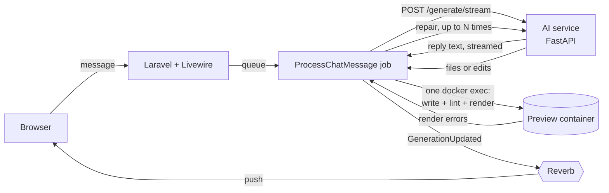

<div align="center">

# SKYLARR

**Chat your way to working Laravel Livewire components, built with [MaryUI](https://mary-ui.com) and running live as you type.**

Laravel 12 · Livewire 3 · MaryUI 2 · FastAPI · OpenAI / Gemini · Docker

</div>

---

Describe what you want, for example *"a users table with a delete button"* or *"add a phone field to the signup form"*. SKYLARR writes the PHP class and the Blade view, runs them in an isolated preview container, fixes anything that fails to render, and shows the result next to the chat.

## Highlights

| | |
| --- | --- |
| **One model call per message** | Structured JSON output decides whether to answer, create or update. No keyword guessing. |
| **Small edits, small cost** | Updates come back as search/replace edits, not full rewrites. If an edit doesn't apply cleanly, the service asks once for complete files. |
| **Grounded in real MaryUI** | Props, slots and 1,288 Heroicons are extracted from the installed MaryUI. Unknown tags and missing required props are caught before anything runs. |
| **Verified before you see it** | Every component is linted and rendered in its container. Errors go back to the model automatically. |
| **Streams as it thinks** | The reply appears in the chat word by word. Progress is pushed over WebSockets (Reverb), with polling as a fallback. |
| **Point at what to change** | Click an element in the preview, or select code in the editor, and the next message changes only that part. |
| **Instant undo and templates** | Restore any of the last 10 versions, or start from a CRUD table, login form, dashboard or settings page, without an AI call. |
| **Cheap to run** | Prompts are ordered for provider caching, repairs use a cheaper model, idle containers pause, and each container step is one `docker exec`. |

## How it works



1. **Generate.** The AI service builds the prompt (static system prompt first, so providers can cache it), calls the model, applies edits, normalizes the files and statically checks the Blade. Certain errors get one cheap repair call here.
2. **Build.** Laravel writes every changed component into the project's container, then lints and renders each one, all in a single `docker exec`.
3. **Repair.** Render errors and their Laravel log message go back to the model, up to `AI_MAX_REPAIR_ATTEMPTS` times.
4. **Show.** The reply, components and versions are saved, the preview reloads, and timings for every stage are recorded.

## Quick start

> **Requirements:** PHP 8.2+, Composer, Bun or Node 18+, Python 3.11+, Docker, and an OpenAI or Gemini API key.

```bash
# 1. AI service
cd scripts
python3 -m venv venv && venv/bin/pip install -r requirements.txt
cp .env.example .env            # then add your API key, see "AI service settings"
venv/bin/uvicorn main:app --host 127.0.0.1 --port 8001

# 2. Laravel app (new terminal)
cd skylarr
composer install && bun install && bun run build
cp .env.example .env && php artisan key:generate
php artisan migrate
composer dev                    # web, queue worker, scheduler, logs, Vite

# 3. Preview image (once, and after changing preview-reference/ or skylarr/docker/)
cd skylarr && ./scripts/build-docker-preview.sh
```

Set the same `AI_SERVICE_TOKEN` in `scripts/.env` and `skylarr/.env`, and put your email in `SKYLARR_ADMIN_EMAILS`. `./start.sh` at the repo root starts the AI service and `composer dev` together.

<details>
<summary><b>AI service settings</b> (<code>scripts/.env</code>)</summary>

```ini
AI_PROVIDER=openai              # or gemini
OPENAI_API_KEY=sk-...
OPENAI_MODEL=gpt-4.1            # main model
OPENAI_FAST_MODEL=gpt-4.1-mini  # optional: repairs and selection edits
# GEMINI_API_KEY=...
# GEMINI_MODEL=gemini-2.5-flash
# GEMINI_FAST_MODEL=gemini-2.5-flash-lite
AI_SERVICE_TOKEN=change-me      # shared secret with Laravel
```

`GET /health` reports the provider, both models and the MaryUI version.
</details>

<details>
<summary><b>Live updates with Reverb</b> (optional)</summary>

Without this, the chat and preview poll while a generation runs. With it, progress is pushed.

```ini
# skylarr/.env
BROADCAST_CONNECTION=reverb
REVERB_APP_ID=skylarr
REVERB_APP_KEY=any-random-string
REVERB_APP_SECRET=another-random-string
REVERB_HOST=localhost
REVERB_PORT=8080
REVERB_SCHEME=http
```

Then run `php artisan reverb:start` next to `composer dev`, and rebuild assets (`bun run build`) so the browser picks up the key.
</details>

<details>
<summary><b>Production notes</b></summary>

- Run `php artisan queue:work --timeout=900` under a process supervisor, plus the scheduler (`schedule:work` or cron).
- Keep `DB_QUEUE_RETRY_AFTER` (and the Redis/Beanstalkd equivalents) above 900 seconds.
- After rebuilding the preview image, remove old containers with `php artisan docker:cleanup-orphaned --all`.
</details>

## Preview containers

Each project gets its own container from `skylarr-preview:latest`.

- **Isolated.** Memory, CPU and process limits; all Linux capabilities dropped except the five nginx/php-fpm need; `no-new-privileges`; the port is bound to `127.0.0.1`. Set `PREVIEW_NETWORK` to a network without internet access to keep generated code offline.
- **Fast.** A warm pool (`PREVIEW_POOL_SIZE`) hands new projects a running container. Every class in `app/Livewire` is served at `/<kebab-name>` automatically, so writing two files is all a change takes.
- **Frugal.** php-fpm starts workers on demand. Containers idle for `PREVIEW_PAUSE_MINUTES` are paused (no CPU, resume in milliseconds), and after `PREVIEW_IDLE_HOURS` they are removed. Their components are restored the next time the project is opened. `php artisan preview:stats` shows live memory use for tuning `PREVIEW_MEMORY`.
- **Admin-only maintenance.** `/api/preview/cleanup*`, `/api/preview/port/{port}` and `/api/preview/remove-all` require an email in `SKYLARR_ADMIN_EMAILS`.

## Measuring quality and speed

```bash
cd skylarr
php artisan skylarr:eval                       # all cases in evals/cases.json
php artisan skylarr:eval --case=users-table --keep
```

Each case runs through the real pipeline and is checked for render errors, components changed, create vs. update, and required or forbidden markup. The report shows:

- **Quality:** pass rate, render rate, average repair attempts
- **Cost:** input, cached and output tokens, cache hit rate, model calls per case
- **Speed:** average milliseconds for each stage: `ai`, `model`, `first_reply`, `container`, `write_check`, `total`

A JSON report is written to `storage/app/evals/`. Run it before and after changing prompts, guides or models.

Thumbs up/down in the chat is saved with the components it produced. `php artisan skylarr:export-feedback --rating=negative` turns rated messages into new eval cases.

## Repository layout

| Path | Contents |
| --- | --- |
| `skylarr/` | Laravel app: auth, projects, chat, preview panel, queue jobs, evals |
| `skylarr/resources/templates/` | Starter templates (`component.php` + `view.blade.php`) |
| `scripts/` | FastAPI AI service: prompts, retrieval, edits, streaming, OpenAI/Gemini adapters |
| `scripts/knowledge/` | MaryUI reference (generated) and usage guides |
| `preview-reference/` | The Laravel app baked into the preview image |

<details>
<summary><b>Updating MaryUI</b></summary>

```bash
cd preview-reference && composer update robsontenorio/mary && cd ..
php scripts/knowledge/extract_maryui.php preview-reference > scripts/knowledge/maryui_reference.json
cd scripts && venv/bin/python -m pytest   # guides and icon lists must still match
```
</details>

<details>
<summary><b>Configuration reference</b></summary>

| Variable | Where | Default | Purpose |
| --- | --- | --- | --- |
| `AI_PROVIDER` | scripts | `openai` | `openai` or `gemini` |
| `OPENAI_MODEL` / `GEMINI_MODEL` | scripts | `gpt-4.1` / `gemini-2.5-flash` | Main model |
| `OPENAI_FAST_MODEL` / `GEMINI_FAST_MODEL` | scripts | main model | Repairs and selection-scoped edits |
| `AI_MAX_OUTPUT_TOKENS` | scripts | `16000` | Output budget per call |
| `AI_SERVICE_TOKEN` | both | empty | Shared secret; empty disables auth (local only) |
| `AI_SERVICE_URL` | skylarr | `http://127.0.0.1:8001` | AI service address |
| `AI_MAX_REPAIR_ATTEMPTS` | skylarr | `2` | Fix rounds when a component fails to render |
| `BROADCAST_CONNECTION` | skylarr | `log` | `reverb` enables pushed updates |
| `SKYLARR_ADMIN_EMAILS` | skylarr | empty | Who may run container maintenance |
| `PREVIEW_PAUSE_MINUTES` | skylarr | `15` | Pause idle containers; `0` disables |
| `PREVIEW_IDLE_HOURS` | skylarr | `24` | Remove idle containers |
| `PREVIEW_*` | skylarr | see `config/skylarr.php` | Image, limits, network, pool size, ports |
| `DB_QUEUE_RETRY_AFTER` | skylarr | `960` | Must exceed the 900 s job timeout |
</details>

## Tests

```bash
cd scripts && venv/bin/python -m pytest
cd skylarr && php artisan test
```

## License

MIT
